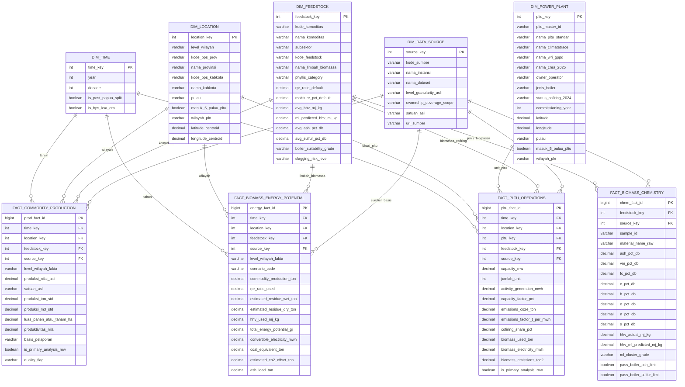
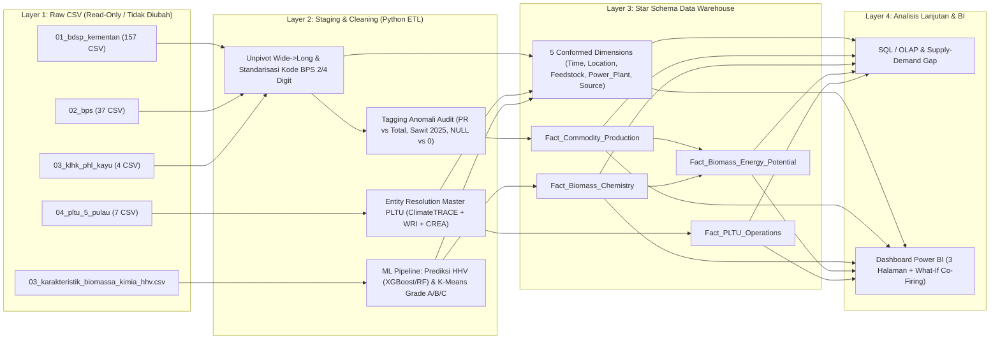

# Plan Fase 3: Perancangan Star Schema Data Warehouse untuk Analisis Lanjutan (BI, ML & Co-Firing PLTU)

> **Status:** Draft Plan (*Menunggu Review & Konfirmasi User sebelum eksekusi ETL / DDL*)  
> **Input Data:** 4 Folder Raw CSV Fase 2 (`205 file / 4.788 baris mentah`, lulus `AUDIT_RAW_DATA.md`) + `raw_data/03_karakteristik_biomassa_kimia_hhv.csv` (`2.229 baris`) + opsional `raw_data/02_sipsn_timbulan_komposisi_sampah.csv` (`3.436 baris`).  
> **Prinsip Utama:** *Strict Scientist / As-Is* — **tidak mengarang angka**, **tidak memecah paksa angka Provinsi ke Kab/Kota**, dan **mencegah *double-counting*** antar-sumber (BDSP vs BPS vs KLHK) melalui pemisahan *grain* dan *conformed dimensions*.

---

## 1. Tujuan Analisis Lanjutan yang Harus Dijawab Star Schema Ini

Berdasarkan konteks proyek di `memori_proyek_bi_green_energy.md` dan data aktual di `raw_data/`, Star Schema ini dirancang untuk mendukung **4 pilar analisis lanjutan** (SQL/OLAP, Machine Learning, dan Dashboard Power BI):

1. **Feedstock Discovery & Screening (ML + Kimia):** Memprediksi nilai kalor (**HHV MJ/kg**) dan mengelompokkan kelayakan *boiler* (**Grade A/B/C**, risiko *slagging* dari *Ash* & *Sulfur*) dari 2.229 sampel kimia biomassa (`03_karakteristik_biomassa_kimia_hhv.csv`).
2. **Analisis Suplai Komoditas & Residu Biomassa Regional (`2010–2025`):** Memetakan tren produksi 5 komoditas utama (**Padi/Sekam, Jagung, Kelapa Sawit, Tebu, Kayu Bulat**) lintas 38 provinsi & 514+ kab/kota, serta menghitung potensi tonase residu kering & energi (GJ / MWh).
3. **Analisis Permintaan & Realisasi Co-Firing PLTU 5 Pulau:** Menganalisis kapasitas (MW), pembangkitan tahunan (MWh), emisi (CO₂e), jenis *boiler* (PC/CFB/Stoker), dan realisasi *co-firing* 2024 dari PLTU batu bara di **Jawa, Sumatera, Kalimantan, Sulawesi, dan Papua**.
4. **Simulasi *Supply–Demand* & *What-If Co-Firing*:** Mencocokkan potensi biomassa per pulau/provinsi/radius logistik terhadap kebutuhan substitusi batu bara (misal skenario 5%, 10%, 20% *co-firing*) dan estimasi penghematan batu bara + reduksi emisi CO₂.

---

## 2. Diagram Star Schema (Mermaid `erDiagram`)

Arsitektur yang dipakai adalah **Multi-Fact Star Schema (Kimball Galaxy / Constellation)** dengan **5 Conformed Dimensions** (1-hop langsung ke tabel fakta, tanpa rantai *snowflake*) dan **4 Tabel Fakta Inti** (+ 1 tabel fakta opsional untuk SIPSN Sampah):

---

## 3. Alur Data End-to-End (Raw 4 Folder → Staging → Star Schema → ML & BI)

---

## 4. Kamus Tabel & Aturan Penanganan Temuan Audit (`AUDIT_RAW_DATA.md`)

Ini bagian krusial agar Star Schema **tidak menipu angka** saat dipakai di Power BI maupun SQL:

### A. Penanganan 6 Temuan Nyata dari `AUDIT_RAW_DATA.md`
| Temuan Audit di Raw Data | Cara Star Schema Menanganinya Secara Saintifik |
| :--- | :--- |
| **1. Multi-Grain Wilayah (`KABKOTA` vs `PROVINSI` vs `PULAU`)** | `DIM_LOCATION` menyimpan `level_wilayah` eksplisit, dan setiap tabel fakta menyimpan `level_wilayah_fakta`. Query/measure DAX wajib filter 1 level saja (atau pakai `is_primary_analysis_row = TRUE` pada 1 level terpilih) agar **0% double-counting**. |
| **2. Kelapa Sawit Kab/Kota BDSP (`2018–2025`) Khusus Perkebunan Rakyat (~16,2 jt ton) vs Total Provinsi (~47,1 jt ton)** | `DIM_DATA_SOURCE.ownership_coverage_scope` memisahkan tegas `PERKEBUNAN_RAKYAT_ONLY` vs `ALL_OWNERSHIP_PR_PBN_PBS`. Di level Provinsi memakai total pengusahaan (`ALL_OWNERSHIP`), sedangkan analisis sebaran Kab/Kota diberi label eksplisit *Perkebunan Rakyat*. |
| **3. Lonjakan Sawit BDSP Provinsi `2025` (`219,88 jt ton`, 4,84× vs 2024)** | Disimpan apa adanya di `FACT_COMMODITY_PRODUCTION`, tetapi diberi `basis_pelaporan = 'SUSPECT_TBS_VS_CPO'` dan `quality_flag = 'ANOMALY_2025_SCALE_4_8X'` (serta `is_primary_analysis_row = FALSE` untuk agregasi CPO standar hingga diverifikasi). |
| **4. Jagung Kab/Kota BDSP (`2018–2022` parsial, `2023–2025` nol semua)** | Level Kab/Kota (`2010–2017`) tetap dipertahankan *as-is*, sedangkan tren nasional/provinsi `2010–2025` memakai `bdsp_jagung_38_provinsi` & `BPS RI 2204#2` (`cocok 0,00%`). Nilai `2026` yang seluruhnya `0,00` diberi `quality_flag = 'UNPUBLISHED_YEAR_2026'`. |
| **5. Kayu Bulat Satuan `m³` (KLHK PBPH + Perhutani) & Cakupan Izin** | `FACT_COMMODITY_PRODUCTION` memisahkan `produksi_ton_std` dan `produksi_m3_std` (tidak mencampur `m³` langsung ke `ton`!). Konversi `m³ → ton` dilakukan transparan saat membentuk `FACT_BIOMASS_ENERGY_POTENTIAL` memakai massa jenis (*wood density*) terdokumentasi di `DIM_FEEDSTOCK`. |
| **6. Entitas PLTU Tumpang-Tindih di 3 Sumber (`100` Climate TRACE vs `70` WRI vs `52` CREA)** | `DIM_POWER_PLANT` berperan sebagai **Master PLTU Terpadu** (hasil pencocokan nama standar + jarak koordinat GPS ≤ 5–10 km). Setiap sumber tetap tersimpan di `FACT_PLTU_OPERATIONS` dengan `source_key` masing-masing + flag `is_primary_analysis_row` agar kapasitas MW tidak terjumlah ganda. |

### B. Ringkasan Grain Setiap Tabel Fakta
| Tabel Fakta | Grain (1 Baris Mewakili) | Sumber Raw CSV |
| :--- | :--- | :--- |
| **`FACT_COMMODITY_PRODUCTION`** | 1 `tahun` × 1 `wilayah` × 1 `komoditas` × 1 `sumber` | `01_bdsp_kementan/` (157 CSV), `02_bps/` (37 CSV), `03_klhk_phl_kayu/` (4 CSV) |
| **`FACT_BIOMASS_CHEMISTRY`** | 1 `sample_id` uji laboratorium biomassa | `03_karakteristik_biomassa_kimia_hhv.csv` (2.229 baris) + output ML (HHV prediksi & klaster) |
| **`FACT_BIOMASS_ENERGY_POTENTIAL`** | 1 `tahun` × 1 `wilayah` × 1 `limbah_biomassa` × 1 `skenario` | Turunan dari `FACT_COMMODITY_PRODUCTION` × parameter RPR/HHV `DIM_FEEDSTOCK` |
| **`FACT_PLTU_OPERATIONS`** | 1 `tahun` × 1 `unit/stasiun PLTU` × 1 `sumber` | `04_pltu_5_pulau/` (`climatetrace/` 2021–2025, `wri_gppd/`, `crea_2025/`) |

*(Opsional)* **`FACT_MUNICIPAL_WASTE_SUPPLY`**: jika dataset eksisting `02_sipsn_timbulan_komposisi_sampah.csv` (3.436 baris) ingin dimasukkan juga untuk skenario RDF/*Waste-to-Energy*, tabel ini langsung terhubung ke `DIM_TIME`, `DIM_LOCATION`, `DIM_FEEDSTOCK`, dan `DIM_DATA_SOURCE` tanpa merusak struktur 4 tabel fakta utama di atas.

---

## 5. Step-by-Step Implementasi Setelah Plan Disetujui

1. **Step 1 — Finalisasi Spesifikasi & DDL (`warehouse/ddl_star_schema.sql`):**
   - Menulis skrip SQL DDL pembuatan 5 Dimensi + 4 Tabel Fakta + *primary/foreign keys* + *indexes* + *analytic views* (misal `vw_supply_vs_pltu_5_pulau`).
2. **Step 2 — ETL Dimensi Master (`scripts/dwh/01_build_dimensions.py`):**
   - Membangun `dim_time`, `dim_location` (38 provinsi + 514+ kab/kota + pemetaan 5 pulau & wilayah PLN), `dim_data_source`, `dim_feedstock` (mapping 5 komoditas → jenis residu + parameter RPR/densitas kayu/batas abu boiler dari literatur ESDM & Phyllis2), dan `dim_power_plant` (entity resolution Climate TRACE + WRI + CREA + log kecocokan).
3. **Step 3 — ML Enrichment untuk `Fact_Biomass_Chemistry` & `Dim_Feedstock` (`scripts/dwh/02_ml_biomass_hhv_cluster.py`):**
   - Melatih model regresi HHV (Random Forest / XGBoost + evaluasi $R^2$/RMSE + SHAP) dan K-Means *suitability grading* (Grade A/B/C) pada 2.229 sampel kimia, lalu mengisi `hhv_ml_predicted_mj_kg` & `boiler_suitability_grade`.
4. **Step 4 — ETL Tabel Fakta (`scripts/dwh/03_build_facts.py`):**
   - Memuat `fact_commodity_production` (dengan *quality flags* anti double-count), `fact_biomass_chemistry`, `fact_biomass_energy_potential` (konversi energi & setara batu bara), dan `fact_pltu_operations`.
5. **Step 5 — Load ke Engine DWH & Export Siap Power BI (`warehouse/`):**
   - Menyimpan output ke **CSV/Parquet Star Schema** di `warehouse/tables/` sekaligus memuat ke database lokal (**DuckDB / SQLite / PostgreSQL**) + menjalankan serangkaian **SQL QA Checks** (referential integrity 100%, 0 orphan FK, cek tidak ada double-counting total nasional).

---

## 6. Keputusan Singkat yang Perlu Kamu Konfirmasi Sebelum Eksekusi

1. **Target Engine Data Warehouse:** Mau dibangun sebagai file **CSV/Parquet Star Schema + DuckDB/SQLite** (paling ringan & langsung bisa dibuka di Power BI Desktop tanpa instal server), atau mau sekalian ke **PostgreSQL / SQL Server**?
2. **Dataset Sampah SIPSN (`02_sipsn_timbulan_komposisi_sampah.csv`, 3.436 baris):** Apakah mau sekalian dimasukkan sebagai Fact Table ke-5 (`FACT_MUNICIPAL_WASTE_SUPPLY` untuk opsi RDF) atau fokus ketat di **5 komoditas pertanian/kehutanan** dulu?
3. **Cakupan Analisis Level Wilayah Utama:** Untuk `FACT_BIOMASS_ENERGY_POTENTIAL`, apakah kita buat **2 view/level terpisah** (Level **Provinsi 2018–2024** lengkap seluruh 5 komoditas *all-ownership* + Level **Kab/Kota** khusus untuk komoditas yang memang tersedia di tingkat Kab/Kota)?
